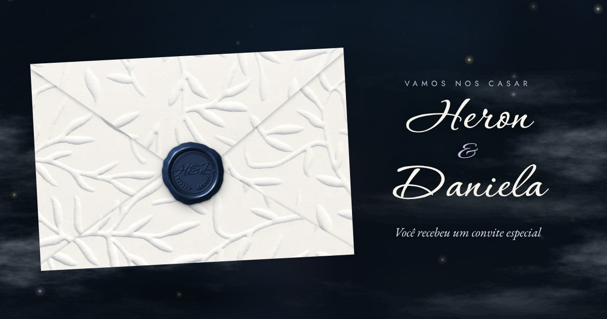

# 💌 Convite de Casamento — Heron & Daniela

Convite digital interativo, 100% estático (HTML + CSS + JavaScript puro, sem build),
feito para rodar no **GitHub Pages**.



## O que tem

**A abertura (o envelope)**
- Envelope 3D feito com o **papel de folhas em relevo** (a foto foi tratada: iluminação corrigida e versão sem emendas).
- Ele flutua, inclina seguindo o mouse (ou o giroscópio, no Android) e tem um brilho que passeia pelo relevo.
- Na frente: o nome do convidado escrito à mão (`?para=`), um selo postal com a foto de vocês e um carimbo dos Correios.
- Ao tocar, o envelope vira. No verso fica o **selo de cera azul "H&D"**, gerado em 3D. Ao tocar no selo, ele racha em duas metades, solta migalhas de cera e o celular vibra.
- A aba abre e mostra o forro azul-noite com folhas prateadas. O convidado puxa o convite para cima com o dedo, a carta vai para o centro e "atravessa a câmera" até a foto, num efeito de foco.

**O convite**
- Capa com a foto, névoa em camadas se movendo, vagalumes que orbitam o cursor/dedo e os nomes **escritos por uma faísca de luz**.
- Toque duplo na foto solta corações e pétalas.
- Contagem regressiva com dígitos que rolam e um coração que bate a cada segundo.
- Programação do dia com um **ramo que cresce conforme a rolagem**: as folhas brotam e os horários acendem.
- Locais com Google Maps, Waze e mapa embutido; botão "adicionar à agenda" (Google Agenda ou arquivo `.ics`).
- Traje com paleta de cores.
- Presentes: **PIX com QR Code gerado automaticamente** (BR Code válido) e botões "copiar chave" e "PIX copia e cola".
- **Confirmação de presença** pelo WhatsApp ou direto numa planilha Google, com pétalas ao confirmar.
- **Trilha sonora gerada no navegador**: uma caixinha de música tocando o Cânone de Pachelbel, além de sons de papel, cera quebrando e carta deslizando. Não usa nenhum arquivo de áudio.
- Silhuetas de pinheiros em parallax, menu, botão flutuante "Confirmar presença".
- Funciona com **movimento reduzido** (acessibilidade), teclado e leitores de tela.

## Feito para o celular

Quase todo convidado vai abrir pelo link do WhatsApp, então o convite foi medido num celular simulado com CPU 6× mais lenta e em redes 4G/3G:

- **Animações só na GPU** (`transform`/`opacity`): nada de animar `height`, `top`, `box-shadow`, `background-position` ou `filter`. Na fase mais pesada da abertura, o envelope fica perto de 60 fps, com o pior quadro em ~17 ms.
- **O conteúdo atrás do envelope não é renderizado** até ele abrir (`content-visibility`). Só 4 das 10 fontes são baixadas no início, e a foto da capa e o gerador de QR carregam enquanto a pessoa abre o envelope. São 288 KB até o envelope ficar pronto para tocar: cerca de 0,5 s no 4G e 1,6 s no 3G.
- Os vagalumes são desenhados em 1× no celular e se adaptam sozinhos (menos partículas, 30 fps) se o aparelho não acompanhar. A névoa pausa fora da tela, e a música e as animações param quando a aba fica em segundo plano.
- Toques com alvos de 44 px e área de toque tolerante no envelope. Arrastar a carta com o dedo, giroscópio no Android e vibração ao quebrar o selo. Respeita a área segura (notch), usa `svh` para as barras do navegador e campos com fonte ≥ 16 px (o iPhone não dá zoom ao digitar).

## 1. Publicar no GitHub Pages

1. Faça o merge desta branch na `main` (ou use a branch atual no passo 3).
2. No GitHub, abra o repositório e vá em **Settings → Pages**.
3. Em *Build and deployment*, escolha **Source: Deploy from a branch** e **Branch: `main` / `(root)`**. Depois clique em **Save**.
4. Em cerca de 1 minuto o convite estará em **https://herondsx.github.io/convite-casamento/**

> Se usar um domínio próprio, troque as URLs de `og:url` e `og:image` no `<head>` do `index.html`.
> Elas são as únicas absolutas e servem para a prévia que aparece no WhatsApp.

## 2. Personalizar: edite só `assets/js/config.js`

| Campo | O que é |
|---|---|
| `noivos` | nomes curtos (capa, envelope) e completos (cartão do convite) |
| `data` | data/hora da cerimônia no formato ISO com fuso, ex. `2027-06-12T16:30:00-03:00` ⚠️ **a data atual é de exemplo** |
| `cidade`, `textos` | frases do convite, do envelope e do rodapé |
| `cerimonia`, `recepcao` | nome do local, endereço, horário e link do mapa (opcional). Use `recepcao: null` se for tudo no mesmo lugar |
| `programacao` | itens do cronograma do dia |
| `traje` | nome, texto, paleta (`nome` + `hex`) e o que evitar |
| `presentes.pix` | **chave PIX**, nome e cidade do recebedor (o QR é gerado sozinho) ⚠️ **a chave atual é de exemplo** |
| `presentes.lista` | link opcional para uma lista de presentes externa |
| `rsvp` | **número do WhatsApp** que recebe as confirmações, prazo e máximo de pessoas |
| `musica` | caminho de um MP3 seu (opcional) e se toca ao abrir o envelope |

Enquanto o PIX ou o WhatsApp não estiverem configurados, aparece um aviso amarelo no próprio convite. Ele some sozinho depois que vocês configuram.

## 3. Links personalizados por convidado

Acrescente `?para=` ao link e o nome aparece escrito no envelope e já vem preenchido no formulário:

```
https://herondsx.github.io/convite-casamento/?para=Tia%20Maria
https://herondsx.github.io/convite-casamento/?para=Família%20Silva&max=4
```

O `max` limita quantas pessoas aquele convite pode confirmar.

Para não montar os links à mão, abra **`/links.html`**. Lá vocês colam a lista de convidados (um por linha, `Nome; 4` para limitar), e a página gera cada link com botões "Copiar" e "WhatsApp", já com uma mensagem pronta.

## 4. Receber as confirmações (RSVP)

**Opção A: WhatsApp (mais simples).** Preencha `rsvp.whatsapp` com DDI + DDD + número, só dígitos (ex.: `5511999998888`).
Ao confirmar, o convidado abre o WhatsApp com a mensagem pronta para vocês.

**Opção B: planilha Google (automático, sem o convidado sair do site)**
1. Crie uma planilha no Google Sheets e abra **Extensões → Apps Script**.
2. Cole o código abaixo e salve:

   ```js
   function doPost(e) {
     const ss = SpreadsheetApp.getActiveSpreadsheet();
     const sh = ss.getSheetByName('RSVP') || ss.insertSheet('RSVP');
     const d = JSON.parse(e.postData.contents);
     if (sh.getLastRow() === 0) sh.appendRow(['Quando', 'Nome', 'Presença', 'Pessoas', 'Restrição', 'Recado', 'Link do convite']);
     sh.appendRow([new Date(), d.nome, d.presenca, d.pessoas, d.restricao, d.mensagem, d.convite]);
     return ContentService.createTextOutput('ok');
   }
   ```
3. **Implantar → Nova implantação → Tipo: App da Web**. Em *Executar como*, escolha **Eu**; em *Quem pode acessar*, escolha **Qualquer pessoa**. Depois clique em **Implantar**.
4. Copie a URL gerada para `rsvp.googleScriptUrl`. Se o WhatsApp também estiver configurado, ele vira plano B caso o envio falhe.

## 5. Música

Por padrão o convite toca uma caixinha de música **sintetizada em tempo real** com o Cânone em Ré de Pachelbel (domínio público).
Para usar uma música sua, coloque o arquivo em `assets/audio/` e preencha `musica.arquivo` (ex.: `'assets/audio/nossa-musica.mp3'`).
A música começa quando o convidado vira o envelope, já que os navegadores só permitem som depois de um toque. O botão no canto superior esquerdo liga e desliga o som, e a escolha fica salva.

## 6. Ver localmente

```bash
python3 -m http.server 8000
```

Abra http://localhost:8000. Abrir o `index.html` direto (duplo clique) também funciona, mas os navegadores bloqueiam fontes e máscaras em `file://`.

## Estrutura

```
index.html            página do convite
links.html            gerador de links personalizados (não é indexado)
assets/
  css/style.css       todo o visual (envelope 3D, névoa, seções)
  js/config.js        ← seus dados
  js/main.js          envelope, contagem, ramo, PIX, RSVP, agenda…
  js/fx.js            vagalumes, pétalas, corações
  js/audio.js         caixinha de música + efeitos sonoros (Web Audio)
  js/vendor/          gerador de QR Code (MIT)
  img/                texturas, selo, névoa, foto, prévia (og.jpg)
  fonts/              Corinthia, Cormorant Garamond, EB Garamond, Jost (OFL)
tools/                scripts Python que geraram as imagens (opcional)
```

## Regenerar as imagens (opcional)

Os assets visuais foram gerados a partir das duas fotos em `tools/fontes/`:

```bash
pip install -r tools/requirements.txt
cd tools
python3 selo.py --cor 30,48,78 --texto "H&D"   # selo de cera (troque a cor se quiser)
python3 papel.py                                  # papel em relevo, versão sem emendas e forro
python3 nevoa.py                                  # névoa
python3 foto.py                                   # foto da capa + versão desfocada
```

## Créditos

- Fontes: [Corinthia](https://github.com/googlefonts/corinthia), [Cormorant Garamond](https://github.com/CatharsisFonts/Cormorant), [EB Garamond](https://github.com/octaviopardo/EBGaramond12) e [Jost](https://github.com/indestructible-type/Jost), todas sob SIL Open Font License 1.1 (veja `assets/fonts/OFL.txt`).
- QR Code: [qrcode-generator](https://github.com/kazuhikoarase/qrcode-generator), de Kazuhiko Arase (MIT).
- Música: Cânone em Ré, de Johann Pachelbel (domínio público), sintetizado no navegador.
